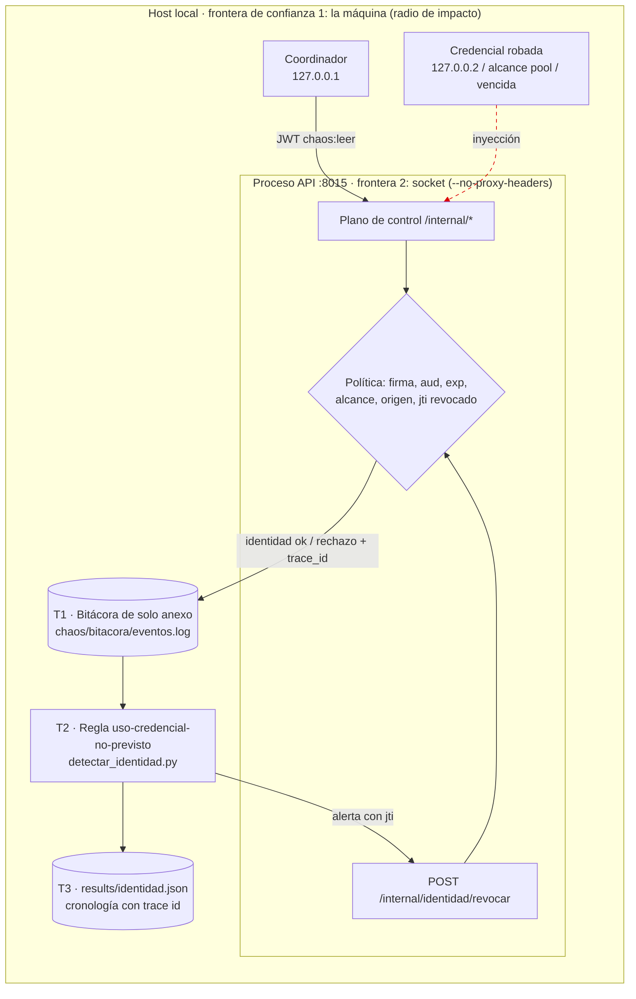

# Caos de Seguridad · Experimento 1: identidad de máquinas

**Autor:** Daniel Morales (`CodeNomad-01`) · Énfasis Defensa en Profundidad 2026-2 · Evaluación final "Caos de Seguridad" · Entrega: 18 de noviembre de 2026.

**Repositorio:** https://github.com/CodeNomad-01/defensa-caos-identidad-exp1

Este repositorio contiene **solo lo necesario para reproducir el experimento 1** del game day del grupo: la API de vuelos que sirve de objetivo, el experimento como código, la regla de detección, las pruebas, la evidencia de las dos rondas y el informe.

> **Origen.** Se deriva del proyecto del grupo [`clic_kiusys`](https://github.com/juangz1912/clic_kiusys) (rama `develop`, v5.1.1), mantenido por Juan José Giraldo. La API base, el interruptor de caos (`app/services/chaos_state.py`), la bitácora de solo anexo (`app/services/bitacora.py`) y el plano de control `/internal/*` vienen de ese repositorio y se conservan sin cambios de lógica, porque el experimento 1 los usa como objetivo. Los experimentos 2, 3 y 4, la infraestructura multinube (Terraform, OKE, canary, k6) y los informes de los otros integrantes viven en el repositorio del grupo y **no** se incluyen aquí.

## Qué es el experimento 1

La credencial del componente que coordina el flujo se usa **desde un origen, con un alcance o en una ventana de tiempo no previstos** (ATT&CK T1550.001 Application Access Token y T1078.004 Cloud Accounts).

| | Ronda 0 (`IDENTIDAD_ESTRICTA=false`) | Ronda 1 (`IDENTIDAD_ESTRICTA=true`) |
| --- | --- | --- |
| Control | Token estático `CHAOS_TOKEN`, sin vencimiento, alcance ni origen | JWT HS256 de 60 s con `aud`, alcance por acción, `jti`, lista de orígenes y revocación |
| Usos adversos aceptados | 3 de 3 | 0 de 3 |
| MTTD (métrica objetivo, T1 ≤ 2 s) | Sin detección | 0,25 s (peor caso) |
| MTTC (T2 ≤ 10 s) | No contenida | 0,02 s |
| Cobertura de detección | 0/3 | 3/3 |
| Falsos positivos | 0 de 10 | 0 de 10 |
| Cobertura de telemetría de identidad | 0 % | 100 % |

Evidencia: corrida del 17 de noviembre de 2026, 17:18:01–17:18:25 UTC (12:18 en Bogotá), en [`chaos/security/results/identidad.json`](chaos/security/results/identidad.json) y [`chaos/bitacora/eventos.log`](chaos/bitacora/eventos.log). Informe completo: [`chaos/security/informe-identidad.md`](chaos/security/informe-identidad.md).

## Diagrama por capas

Puntos de inyección (línea punteada roja), fronteras de confianza (recuadros) y puntos de recolección de telemetría (`T`).



| Capa | Qué se protege | Punto de inyección | Telemetría |
| --- | --- | --- | --- |
| Identidad de máquina | Credencial del coordinador sobre `/internal/*` | Uso desde `127.0.0.2`, con alcance `chaos:pool`, y con credencial vencida | Líneas `identidad ok` / `identidad rechazo` con `sub`, `jti`, origen y `trace_id` |
| Detección y respuesta | Regla y revocación | — | Alertas JSON de `detectar_identidad.py`, línea `contencion identidad` |

## Tabla de trazabilidad control – experimento – marco de referencia

| Control | Experimento / condición | ISO/IEC 27001:2022 Anexo A | NIST SP 800-53 | NIST SP 800-207 | ATT&CK / D3FEND |
| --- | --- | --- | --- | --- | --- |
| Credencial efímera del coordinador (60 s, `aud`, `jti`) | 1 · token robado y reusado fuera de su ventana | A.5.17 Información de autenticación; A.8.5 Autenticación segura | IA-5 Gestión de autenticadores; IA-9 Identificación y autenticación de servicios | Acceso por sesión (tenet 3) | T1550.001 / D3-CRO |
| Alcance por acción (mínimo privilegio) | 1 · credencial de telemetría pidiendo el pool | A.8.2 Derechos de acceso privilegiado; A.5.15 Control de acceso | AC-6 Mínimo privilegio; AC-3 Aplicación del acceso | Mínimo privilegio, política dinámica (tenet 4) | T1550.001 / D3-AZET |
| Lista de orígenes del coordinador | 1 · uso desde 127.0.0.2 | A.8.5 Autenticación segura; A.8.20 Seguridad de redes | AC-3; SC-7 Protección de frontera | El origen es un atributo de la política dinámica (tenet 4) y se verifica antes de cada acceso (tenet 6) | T1078.004 / D3-ANET |
| Revocación por `jti` sin reiniciar | 1 · contención | A.5.18 Derechos de acceso; A.5.26 Respuesta a incidentes | IA-5; IR-4 Manejo de incidentes | Acceso revocable en cada sesión (tenet 6) | D3-CR |
| Bitácora de solo anexo con trace id | 1 · reconstrucción de la cronología | A.8.15 Registro de eventos | AU-2, AU-3 Contenido de los registros; AU-9 Protección de la información de auditoría | Recolección de estado para mejorar la postura (tenet 7) | — |
| Regla `uso-credencial-no-previsto` (detección como código) | 1 · casos positivo y negativo | A.8.16 Actividades de monitoreo | AU-6 Revisión y análisis; SI-4 Monitoreo del sistema | Verificación continua | D3-ANET |

La **microsegmentación** de 800-207 corresponde al experimento 2 (exposición y segmentación), que vive en el repositorio del grupo.

## Cómo ejecutarlo

Requisitos: Python 3.12. No se necesita Docker, base de datos ni `.env` (la API usa una SQLite desechable en `chaos/runtime/`).

```powershell
# Windows (PowerShell)
python -m venv .venv
.venv\Scripts\python -m pip install -r requirements.txt
.venv\Scripts\python -m pytest -q                                    # 17 pruebas: 12 del experimento 1 + 5 de la API base
.venv\Scripts\python chaos/security/run_identidad.py --pausas        # demo paso a paso (Enter avanza)
```

```bash
# Linux / macOS
python3 -m venv .venv && .venv/bin/pip install -r requirements.txt
.venv/bin/python -m pytest -q
.venv/bin/python chaos/security/run_identidad.py --pausas
```

Otras opciones: `run_identidad.py` sin `--pausas` corre las dos rondas sin detenerse; `--ronda 0` o `--ronda 1` corre solo una (y no reescribe el JSON de resultados).

> **Evidencia.** Cualquier corrida completa de las dos rondas (con o sin `--pausas`) **reescribe** `chaos/security/results/identidad.json`, y las pruebas y corridas **anexan** líneas a `chaos/bitacora/eventos.log`. La evidencia del informe es la versión versionada del 17 de noviembre. Para volver a ella: `git checkout -- chaos/security/results/identidad.json chaos/bitacora/eventos.log`.

### Variable de parada y reversión

- **Parada:** `Ctrl+C` en cualquier momento, o automática si `GET /api/v2/health` deja de responder antes de cada uso adverso (`parada()` en `run_identidad.py`).
- **Reversión automática:** el bloque `finally` de cada ronda manda `POST /internal/chaos {"tipo":"off"}` con una credencial de alcance `chaos:revertir` y apaga el proceso de la API.
- **Verificación:** al final de cada ronda se comprueba telemetría en `true` y pool inactivo (`estado_inicial_verificado: true` en el JSON).
- **Reversión manual:** `POST /internal/chaos {"tipo":"off"}` con el token estático (ronda 0) o con un JWT de alcance `chaos:revertir` (ronda 1).

## Contenido

| Ruta | Qué es |
| --- | --- |
| `app/services/identidad.py` | Emisor y validador de la credencial efímera, revocación por `jti` |
| `app/routes/internal_chaos.py` | Plano de control `/internal/*` con alcance por acción y `POST /internal/identidad/revocar` |
| `app/config.py` | Variables `IDENTIDAD_*` |
| `chaos/security/run_identidad.py` | Experimento como código: ronda 0 y ronda 1, parada y reversión |
| `chaos/security/experiments/identidad.json` | Manifiesto del experimento (hipótesis, radio, parada, reversión) |
| `chaos/security/detecciones/uso-credencial-no-previsto.json` | Regla de detección como código |
| `chaos/security/detectar_identidad.py` | Ejecutor de la regla sobre la bitácora |
| `chaos/security/results/identidad.json` | Resultados y cronología de las dos rondas |
| `chaos/security/ia/analisis-identidad.md` | Contraste del asistente de IA contra la telemetría |
| `chaos/security/informe-identidad.md` | Informe del experimento |
| `chaos/security/informe-identidad.pdf` | El mismo informe en PDF (6 páginas) |
| `tests/test_identidad.py` | 12 pruebas, incluidos los casos positivo y negativo de la regla |
| `app/` (resto) y `tests/test_api.py` | API base del grupo, necesaria para levantar el objetivo |

Nota: `app/routes/internal_chaos.py` conserva la ruta `/internal/senuelo` del experimento 3 del grupo; no participa en el experimento 1.

## Sin secretos

No hay credenciales reales en el repositorio. `CHAOS_TOKEN=caos-local` es un valor de laboratorio, y el secreto HMAC del emisor lo genera `run_identidad.py` al azar en cada corrida. `.env`, `.venv` y `chaos/runtime/` están en `.gitignore`.
